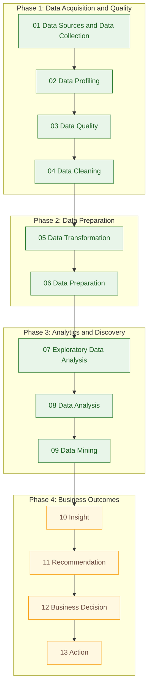

# Data Processes Architecture and Workflow

Portfolio-oriented project documentation for a 13-stage data lifecycle that progresses from source collection and quality control to analytics, recommendations, business decisions, and action.

[](https://www.python.org/)
[](https://jupyter.org/)
[](Data_Processes.md)
[](#process-stages)
[](#current-implementation-status)

> This repository organizes the data lifecycle into a repeatable architecture, from source acquisition, profiling, and quality control through transformation, analysis, and downstream business action planning.

## At a Glance

| Area | Current State |
|---|---|
| Architecture scope | 13-stage lifecycle defined in [Data_Processes.md](Data_Processes.md) |
| Current notebook coverage | Notebook files available for stages 01 to 09 in [notebooks](notebooks) |
| Documentation location | [README.md](README.md) and [Data_Processes.md](Data_Processes.md) |
| Technology stack | Python, Jupyter notebooks, Markdown, pip requirements |
| Data quality focus | Profiling, missing-value analysis, duplicates, type checks, consistency, integrity, anomaly checks |
| Current implementation scope | Architecture and stage notebooks are documented; execution outcomes are not yet centrally versioned |
| Next implementation milestone | Add executable assets or formal outputs for stages 10 to 13 |

## Table of Contents

- [Overview](#overview)
- [Current Implementation Status](#current-implementation-status)
- [Architecture and Data Flow](#architecture-and-data-flow)
- [Process Stages](#process-stages)
- [Stage-to-Notebook Mapping](#stage-to-notebook-mapping)
- [Data Quality and Reliability](#data-quality-and-reliability)
- [Technology Stack](#technology-stack)
- [Project Structure](#project-structure)
- [Setup and Execution](#setup-and-execution)
- [Current Gaps and Next Improvements](#current-gaps-and-next-improvements)
- [License](#license)

## Overview

The project documents and organizes a complete data process architecture with 13 ordered stages, from acquisition to business action.

Primary architecture reference:

- [Data_Processes.md](Data_Processes.md)

Notebook execution assets currently present:

- [notebooks/01_Data_Sources_and_Data_Collection.ipynb](notebooks/01_Data_Sources_and_Data_Collection.ipynb)
- [notebooks/02_Data_Profiling.ipynb](notebooks/02_Data_Profiling.ipynb)
- [notebooks/03_Data_Quality.ipynb](notebooks/03_Data_Quality.ipynb)
- [notebooks/04_Data_Cleaning.ipynb](notebooks/04_Data_Cleaning.ipynb)
- [notebooks/05_Data_Transformation.ipynb](notebooks/05_Data_Transformation.ipynb)
- [notebooks/06_Data_Preparation.ipynb](notebooks/06_Data_Preparation.ipynb)
- [notebooks/07_EDA.ipynb](notebooks/07_EDA.ipynb)
- [notebooks/08_Data_Analysis.ipynb](notebooks/08_Data_Analysis.ipynb)
- [notebooks/09_Data_Mining.ipynb](notebooks/09_Data_Mining.ipynb)

## Current Implementation Status

The repository currently contains notebook files for 9 out of 13 stages. Stages 10 to 13 are documented in architecture text but do not currently have stage-specific notebook files in the repository.

Important scope note:

- Notebook file availability indicates implementation assets exist.
- This README does not claim that all notebooks have been execution-validated end to end.

## Architecture and Data Flow

The diagram below groups stages into four lifecycle phases while preserving the documented stage order.



Legend:

- Green nodes: notebook files available in this repository.
- Amber nodes: stage is documented in [Data_Processes.md](Data_Processes.md) but notebook asset is not currently present.

## Process Stages

All stage definitions are derived from [Data_Processes.md](Data_Processes.md).

| Stage | Name | Description | Implementation Status |
|---|---|---|---|
| 01 | Data Sources and Data Collection | Identifies required data sources and collection interfaces (files, databases, APIs, cloud stores). | Notebook file available |
| 02 | Data Profiling | Establishes baseline structure, quality signals, and statistical characteristics before cleaning. | Notebook file available |
| 03 | Data Quality | Evaluates trustworthiness through completeness, validity, consistency, uniqueness, and integrity checks. | Notebook file available |
| 04 | Data Cleaning | Resolves quality issues through deduplication, null handling, type correction, and standardization. | Notebook file available |
| 05 | Data Transformation | Converts cleaned data into analysis-ready structures using selection, derivation, joins, and aggregation. | Notebook file available |
| 06 | Data Preparation | Prepares transformed data for analytics and ML workflows with schema alignment and feature-ready shaping. | Notebook file available |
| 07 | Exploratory Data Analysis | Explores distributions, relationships, trends, and anomalies in prepared data. | Notebook file available |
| 08 | Data Analysis | Answers business questions using descriptive, comparative, trend, and root-cause analysis. | Notebook file available |
| 09 | Data Mining | Discovers predictive or hidden patterns via techniques such as classification, clustering, and anomaly detection. | Notebook file available |
| 10 | Insight | Converts analytical findings into prioritized business insights. | Documented, notebook not present |
| 11 | Recommendation | Maps insights to actions with expected impact, effort, and success metrics. | Documented, notebook not present |
| 12 | Business Decision | Selects options with rationale, ownership, and timeline. | Documented, notebook not present |
| 13 | Action | Defines implementation plan, KPI tracking, and post-implementation validation loop. | Documented, notebook not present |

## Stage-to-Notebook Mapping

Implementation matrix based on repository file availability:

| Stage | Process | Notebook | Status |
|---|---|---|---|
| 01 | Data Sources and Data Collection | [notebooks/01_Data_Sources_and_Data_Collection.ipynb](notebooks/01_Data_Sources_and_Data_Collection.ipynb) | Available |
| 02 | Data Profiling | [notebooks/02_Data_Profiling.ipynb](notebooks/02_Data_Profiling.ipynb) | Available |
| 03 | Data Quality | [notebooks/03_Data_Quality.ipynb](notebooks/03_Data_Quality.ipynb) | Available |
| 04 | Data Cleaning | [notebooks/04_Data_Cleaning.ipynb](notebooks/04_Data_Cleaning.ipynb) | Available |
| 05 | Data Transformation | [notebooks/05_Data_Transformation.ipynb](notebooks/05_Data_Transformation.ipynb) | Available |
| 06 | Data Preparation | [notebooks/06_Data_Preparation.ipynb](notebooks/06_Data_Preparation.ipynb) | Available |
| 07 | Exploratory Data Analysis | [notebooks/07_EDA.ipynb](notebooks/07_EDA.ipynb) | Available |
| 08 | Data Analysis | [notebooks/08_Data_Analysis.ipynb](notebooks/08_Data_Analysis.ipynb) | Available |
| 09 | Data Mining | [notebooks/09_Data_Mining.ipynb](notebooks/09_Data_Mining.ipynb) | Available |
| 10 | Insight | Not yet available in repository | Planned (documented stage) |
| 11 | Recommendation | Not yet available in repository | Planned (documented stage) |
| 12 | Business Decision | Not yet available in repository | Planned (documented stage) |
| 13 | Action | Not yet available in repository | Planned (documented stage) |

## Data Quality and Reliability

### Data Quality Controls

The architecture documentation includes these quality-control themes:

- Missing-value analysis and handling.
- Duplicate detection and removal.
- Data type validation and correction.
- Consistency and validity checks.
- Referential integrity checks.
- Outlier and anomaly analysis.

Reference: [Data_Processes.md](Data_Processes.md).

### Operational Reliability

Repository-supported reliability practices include:

- Virtual environment usage through local environment folders such as `myenv`.
- Dependency management via [requirements.txt](requirements.txt).
- Secret and local-artifact exclusion rules in [.gitignore](.gitignore), including `.env` and virtual environment paths.

## Technology Stack

| Category | Technology | Purpose |
|---|---|---|
| Programming language | Python | Notebook execution and data-processing implementation |
| Execution environment | Jupyter + ipykernel | Interactive stage-wise notebook workflow |
| Notebook workflow | Jupyter Notebooks (`.ipynb`) | Stage-specific lifecycle execution assets |
| Process documentation | Markdown (`README.md`, `Data_Processes.md`) | Architecture definition and project communication |
| Environment isolation | Virtual environment (`myenv`) | Local dependency isolation |
| Dependency management | pip + [requirements.txt](requirements.txt) | Reproducible package installation |

## Project Structure

<details>
<summary>Repository tree</summary>

```text
Data_Processes_Project/
|- README.md
|- Data_Processes.md
|- requirements.txt
|- .gitignore
|- .env
|- INTERVIEW_STAR_STORY.md
|- RESUME_PROJECT_INFO.md
|- myenv/
`- notebooks/
   |- 01_Data_Sources_and_Data_Collection.ipynb
   |- 02_Data_Profiling.ipynb
   |- 03_Data_Quality.ipynb
   |- 04_Data_Cleaning.ipynb
   |- 05_Data_Transformation.ipynb
   |- 06_Data_Preparation.ipynb
   |- 07_EDA.ipynb
   |- 08_Data_Analysis.ipynb
   `- 09_Data_Mining.ipynb
```

</details>

Security note:

- `.env` is listed for structure visibility only; do not commit secret values.

## Setup and Execution

1. Prerequisites
   - Ensure Python is installed.
   - Confirm notebook files exist under [notebooks](notebooks).

2. Environment setup
   - If `myenv` already exists, activate it:

   ```powershell
   .\myenv\Scripts\Activate.ps1
   ```

3. Dependency installation
   - If `myenv` exists, install requirements with:

   ```powershell
   .\myenv\Scripts\python.exe -m pip install -r .\requirements.txt
   ```

4. Environment configuration
   - Keep configuration in `.env`.
   - Do not commit credentials, tokens, or connection strings.

5. Notebook execution order
   - [notebooks/01_Data_Sources_and_Data_Collection.ipynb](notebooks/01_Data_Sources_and_Data_Collection.ipynb)
   - [notebooks/02_Data_Profiling.ipynb](notebooks/02_Data_Profiling.ipynb)
   - [notebooks/03_Data_Quality.ipynb](notebooks/03_Data_Quality.ipynb)
   - [notebooks/04_Data_Cleaning.ipynb](notebooks/04_Data_Cleaning.ipynb)
   - [notebooks/05_Data_Transformation.ipynb](notebooks/05_Data_Transformation.ipynb)
   - [notebooks/06_Data_Preparation.ipynb](notebooks/06_Data_Preparation.ipynb)
   - [notebooks/07_EDA.ipynb](notebooks/07_EDA.ipynb)
   - [notebooks/08_Data_Analysis.ipynb](notebooks/08_Data_Analysis.ipynb)
   - [notebooks/09_Data_Mining.ipynb](notebooks/09_Data_Mining.ipynb)

Alternative if `myenv` does not exist yet:

```powershell
python -m venv myenv
.\myenv\Scripts\Activate.ps1
.\myenv\Scripts\python.exe -m pip install -r .\requirements.txt
```

## Current Gaps and Next Improvements

| Area | Current Status | Recommended Next Step |
|---|---|---|
| Notebook implementation | Stages 01 to 09 have notebook files in [notebooks](notebooks). | Add executable assets for stages 10 to 13. |
| Stages 10 to 13 | Defined in [Data_Processes.md](Data_Processes.md) but not represented by notebook files. | Add stage-specific notebooks, scripts, or documented output templates. |
| Run-summary metrics | No centralized stage-duration or run-summary artifacts are currently versioned. | Add lightweight run summary logs and stage completion metadata. |
| Data quality reporting | Quality themes are documented, but no repository-level consolidated report artifact is present. | Add a standard output format for quality checks per stage. |
| Automated testing | No automated test suite or CI workflow is currently present. | Add basic notebook validation checks and optional CI linting/testing. |
| Execution validation | End-to-end execution validation evidence is not currently consolidated in repository docs. | Maintain an execution evidence section with dated run notes and outcomes. |

## License

No `LICENSE` file is currently present in this repository.
